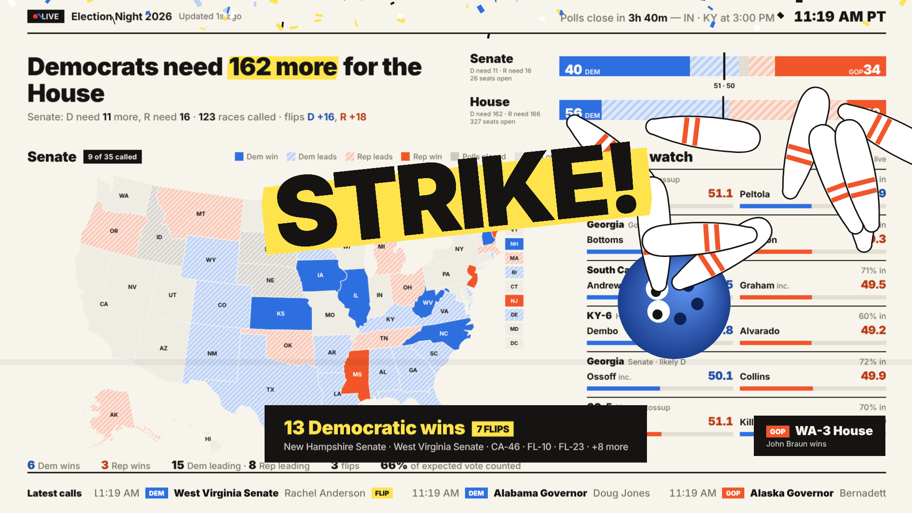

# Election Night Viewer

A single-file, zero-dependency election night dashboard built for a big screen: live results, a US map,
prediction-market odds, and a celebration every time a race is called for the Democrats.

**Live:** https://election.ayushmahajan.com

Open `index.html` in any modern browser. No build step, no server required, nothing to install.
Everything updates on its own; there are no menus to click through, so it works on a TV across the room.

## Data sources
| What | Source | Refresh |
|---|---|---|
| Vote counts, race calls, flips, ratings, poll-closing times | AP results as published by The New York Times (`static01.nyt.com/elections-assets/…/results-{senate,house,governor}.json`) | 30 s |
| Win probabilities and 24-hour price history | Polymarket public APIs (`gamma-api.polymarket.com`, `clob.polymarket.com`) | 90 s |
| California governor, Assembly, State Senate and ballot measures | California Secretary of State (`api.sos.ca.gov/returns/…`) | 2 min |

All three APIs are public and CORS-enabled, so the page fetches them directly from the browser. All times are shown in Pacific time.

## What's on screen
- **Headline** — what each party still needs for the Senate (House on the line below), with the yellow highlighter treatment.
- **Balance bars** — Senate and House seats: solid = called, hatched = currently leading, marker at the majority line.
- **Map** — cycles Senate → Governors → House every 24 s (or click the title). Solid = called, hatched = leading, mid-grey = polls closed and counting, light = polls still open. For states that
  close in two time zones (KY, IN, FL, NH, TX, MI, KS, ND, ID) the feed gives the first closing time; the page uses AP's
  last-close time for those to mark the state closed and to label when a race can be called, since AP doesn't call a
  statewide race until the last polls in the state close.
- **Rotating panel** (every 20 s; ‹ › arrows, the dots, or ← → keys switch it, which turns auto-rotation off; the
  "Auto" button turns it back on):
  1. **Races to watch** — the closest contests with votes in; toss-ups by poll-closing time before then
  2. **Odds board** — Polymarket chance of Senate and House control with a 24-hour sparkline, then key races showing
     live vote share beside market odds (▲▼ = move since last refresh). Texas and Michigan Senate are pinned on top.
  3. **Poll closings** — the next closing waves and the marquee races in each
  4. **Vote remaining** — for uncalled races: the leader's margin, the estimated votes still out, and the share of what's
     left the trailing candidate needs
  5. **California** — governor, Assembly and State Senate leads with the two-thirds supermajority line, and the closest
     contested districts
  6. **California props** — every statewide measure, sorted by how close it is
  Panels with nothing to show yet are skipped automatically.
- **Runoff tracking** — races with a 50% threshold (Georgia statewide → Dec 1; Louisiana House → Dec 12) get a "runoff
  likely" badge once nobody is clearing it, and "RUNOFF" when one is declared.
- **Latest calls** ticker, "next poll closing" countdown with the states closing and how many have closed so far, live clock.
- **Dark mode** and **sound** toggles bottom-right (also `D` and `S` keys; `#dark` in the URL starts dark). Sounds are
  synthesized in the browser — nothing to download — and stay off until you turn them on once, which also satisfies
  browser autoplay rules. Both settings are remembered.

## The fun part
Every Democratic call fires one of eight animations in rotation, with confetti, a screen shake and (if sound is on) its
own sound effect — rolling ball and pin crash, rocket whistle and boom, bat crack, reel ticks and jackpot chime, kick and
ref whistle, plus a crowd cheer: a bowling strike
(googly-eyed ball), the state itself launching as a rocket and bursting into fireworks, a donkey piñata getting whacked,
a slot machine landing D·D·D with a jackpot coin rain, a boot kicking a field goal, a stampede of blue donkeys,
a blue wave crashing across the screen, and a UFO beaming the state up into the mothership. A burst of calls at once
becomes one combined celebration. Republican calls get a quiet corner toast.

## Running it
- **Full screen on a PC:** `Open on this PC (fullscreen).bat` (Chrome kiosk mode; Alt+F4 quits), or just open `index.html`.
- **Preview the night with fake results:** `Preview demo night.bat`, or add `#demo` to the URL.
- **On a TV with a browser:** `Serve to TV.bat` serves the folder on your LAN (`python -m http.server 8000`); open
  `http://<pc-ip>:8000/` on the TV. On Android TV you can launch it over ADB:
  `adb shell am start -a android.intent.action.VIEW -d "http://<pc-ip>:8000/"` (needs a browser app installed on the TV).

## Deploying
It's a static page, so any static host works. On Vercel:

- **CLI:** `npx vercel --prod` from the folder (first run signs you in and creates the project; `vercel.json` and
  `.vercelignore` are already set up — no build command, output is the folder itself, `index.html` is served with
  `Cache-Control: no-cache` so edits show up immediately).
- **From GitHub:** vercel.com/new → import this repo → framework "Other", leave build/output empty → Deploy. Every push
  redeploys.

**Custom domain (Cloudflare DNS):** in Vercel, Settings → Domains → add the subdomain. In Cloudflare, add a `CNAME`
record for it pointing to `cname.vercel-dns.com` with proxy status **DNS only** (grey cloud) — with the orange proxy on,
Vercel can't verify the domain or issue its certificate. The domain goes valid within a couple of minutes and Vercel
provisions HTTPS automatically.

Once hosted, a TV just needs a browser pointed at the URL (TV Bro or Chrome on Android/Google TV; Silk on Fire TV);
the ADB scripts below are only for serving from a PC on the same network.

## Keys
`T` random celebration · `1`–`8` a specific one (test keys need Shift, `#demo` or `?debug`) · `←` `→` or `P` switch panel · `M` next map · `D` dark mode · `S` sound · `#demo` in the URL for fake results.
Calls already on screen when the page first loads don't re-trigger (remembered in `localStorage`), so refreshing is safe.

## Notes
- Race calls and the "flip" flag are AP's. Expected-vote totals are AP estimates and get revised during the night.
- Polymarket market slugs follow `<state>-senate-election-winner` and `<state>-governor-winner-2026`; races without a
  market don't appear on the odds board.
- The map geometry is from [us-atlas](https://github.com/topojson/us-atlas) (Albers USA), simplified and inlined.

MIT License.
